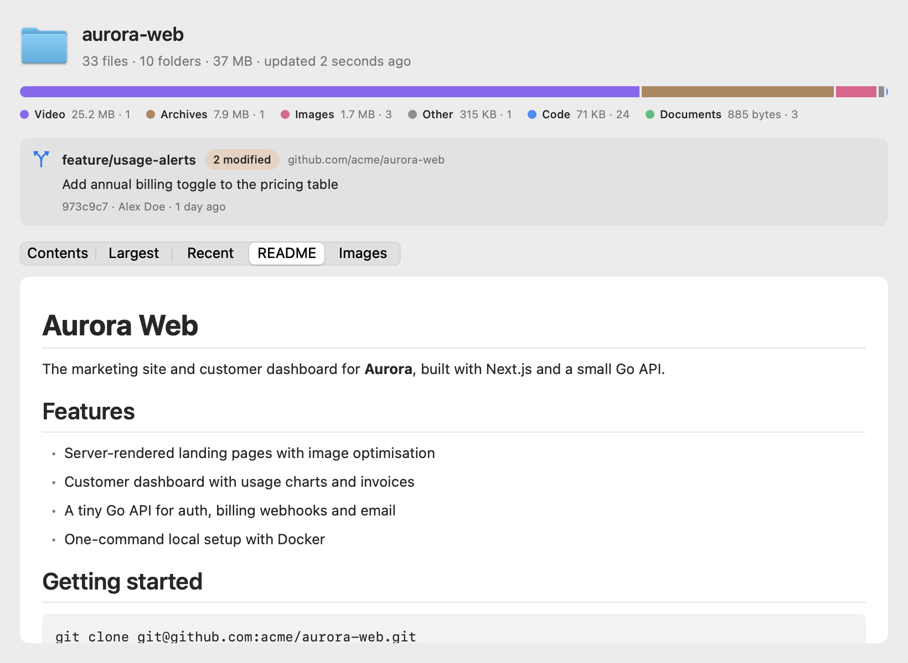
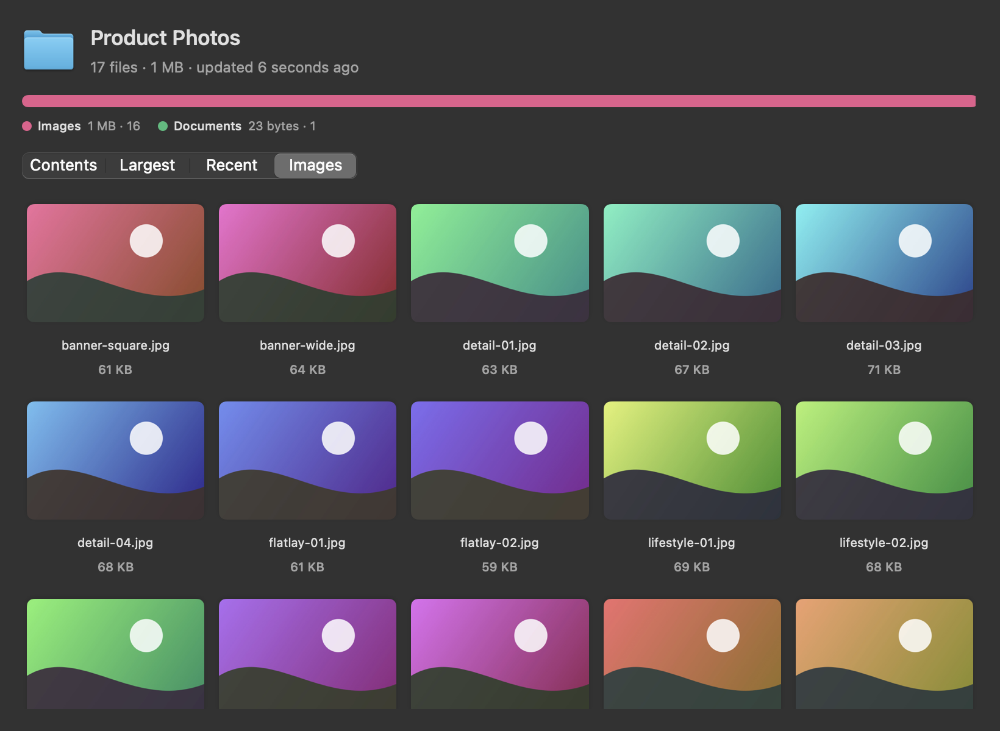
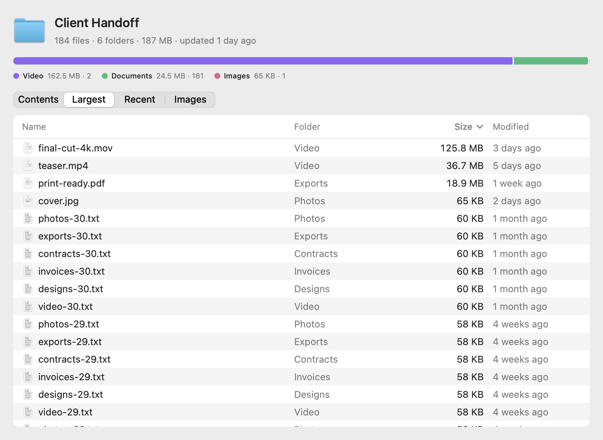

# Folderglass: Folder Preview for Mac

**See what's inside a folder without opening it.** Folderglass is a free, open-source Quick Look extension for macOS. Select a folder in Finder, press Space, and you get its real size, what kind of files fill it, the biggest and newest files, and for code projects the git branch, last commit and rendered README.

Use it to:

- find out what's eating space in a folder, subfolders included, before you open it
- see which files changed most recently in a project or download folder
- check a repo's branch, last commit and uncommitted changes from Finder
- read a project's README without opening an editor
- flip through a folder of photos as a thumbnail grid
- look inside a `.zip` without unpacking it, and preview Markdown files with headings, lists, code and tables

**[Download Folderglass](../../releases/latest)** · [Website](https://dev.adityarajsingh.com/folderglass/) · [Compare Quick Look folder apps](https://dev.adityarajsingh.com/folderglass/comparison/)

https://github.com/user-attachments/assets/bb9215a0-34ae-41e1-b039-8b93644f08f0

<p align="center">
  
</p>

## Features

- **Real folder size.** Counts every file in every subfolder, scanned in the background so Finder never waits. Results fill in as the scan runs.
- **File-type breakdown.** A bar shows how much space video, images, code, documents, archives and audio take.
- **Contents, Largest, Recent.** Sortable tables of the folder's items with their full sizes, the 100 largest files anywhere inside, and the 100 most recently changed.
- **Git at a glance.** Branch, last commit, author, and how many tracked files are modified or deleted. Linked worktrees work too.
- **README inside the preview.** Headings, lists, code blocks, quotes and tables, rendered offline.
- **Image grid.** Folders that are mostly pictures open straight to thumbnails.
- **Zip contents.** Press Space on a `.zip` to see its files, sizes and type breakdown.
- **Markdown files.** `.md` files get the same renderer as READMEs.
- **Light and dark mode,** Apple Silicon and Intel, macOS 14 Sonoma or later.
- **Private by design.** No network access, no analytics, read-only. Folderglass never writes to the folders you preview.

<p align="center">
  
  
</p>

## Install

### Option 1: Homebrew

Homebrew builds Folderglass from source on your Mac.

```bash
brew install justadityaraj/tap/folderglass
ln -sf "$(brew --prefix)/opt/folderglass/Folderglass.app" /Applications/Folderglass.app
open /Applications/Folderglass.app
```

Opening Folderglass once switches the Quick Look extension on. Update later with `brew upgrade folderglass`.

### Option 2: Download the app

1. Download `Folderglass.dmg` from the [latest release](../../releases/latest).
2. Open it and drag Folderglass into Applications.
3. Open Folderglass. If macOS asks whether to open an app downloaded from the internet, click **Open**.
4. Folderglass's window shows **Quick Look extension is on**. You only do this once.

Now select any folder in Finder and press Space.

## Troubleshooting

**You installed it when it was called Foldout.** Folderglass was named Foldout until version 0.2.0. Homebrew users get the new name with `brew upgrade`. If you used the DMG, drag Foldout to the Trash and install Folderglass. Folderglass switches the old extension off the first time it opens.

**Another app's preview shows up instead.** macOS uses one Quick Look extension per file type. Open **System Settings → General → Login Items & Extensions → Quick Look** and turn off the other folder preview extensions, or click **Extension Settings…** in Folderglass.

**Nothing changed after installing.** Open Folderglass once, then run `qlmanage -r` in Terminal to reset Quick Look's cache.

**The scan says it stopped early.** Folderglass stops after 15 seconds or a million items so huge folders like your whole home folder stay responsive. Everything counted so far is shown.

**Some folders show fewer files than expected.** macOS keeps data from other apps, Mail, Messages and cloud-drive folders private, so Folderglass skips them instead of asking for access.

## Build from source

You need the Xcode Command Line Tools or Xcode 16 or later (Swift 6).

```bash
git clone https://github.com/justadityaraj/folderglass.git
cd folderglass
./scripts/build.sh --install
```

`build.sh` runs the self-check and builds universal release binaries. It packages the app and its Quick Look extension as `build/Folderglass.app`. `--install` copies it to `/Applications` and turns the extension on. `--release` also writes `build/Folderglass.dmg` and `build/Folderglass.zip`.

| Path | Contents |
| --- | --- |
| `Sources/FolderglassCore` | Folder scanning, git reading, zip listing and Markdown parsing. No UI. |
| `Sources/FolderglassUI` | The SwiftUI preview shared by the extension and the snapshot tool. |
| `Sources/FolderglassPreview` | The Quick Look extension. |
| `Sources/Folderglass` | The app that installs and switches on the extension. |
| `Sources/FolderglassSelfCheck` | Checks for the core logic. Run with `swift run FolderglassSelfCheck`. |
| `Sources/FolderglassSnapshots` | Renders a preview to PNG: `swift run FolderglassSnapshots <path> out.png [light\|dark]`. |

`swift scripts/demo-data.swift build/demo` makes the sample folders used in the screenshots.

## Signing

Releases from 0.1.3 on are signed with a Developer ID certificate and notarized by Apple, so they open without a security warning. The certificate belongs to the Apple Developer account of Swagloop Ventures Private Limited, a company I'm a director of. It's the developer account I already have, and it saves you the Open Anyway step.

Folderglass is still my personal project. Swagloop doesn't own it, fund it or receive any data from it, and the MIT license covers all of it. If a future release is signed under a different account, nothing changes in how you install or use it. Homebrew builds aren't affected either way, because they're built on your own Mac.

## License

[MIT](LICENSE)
